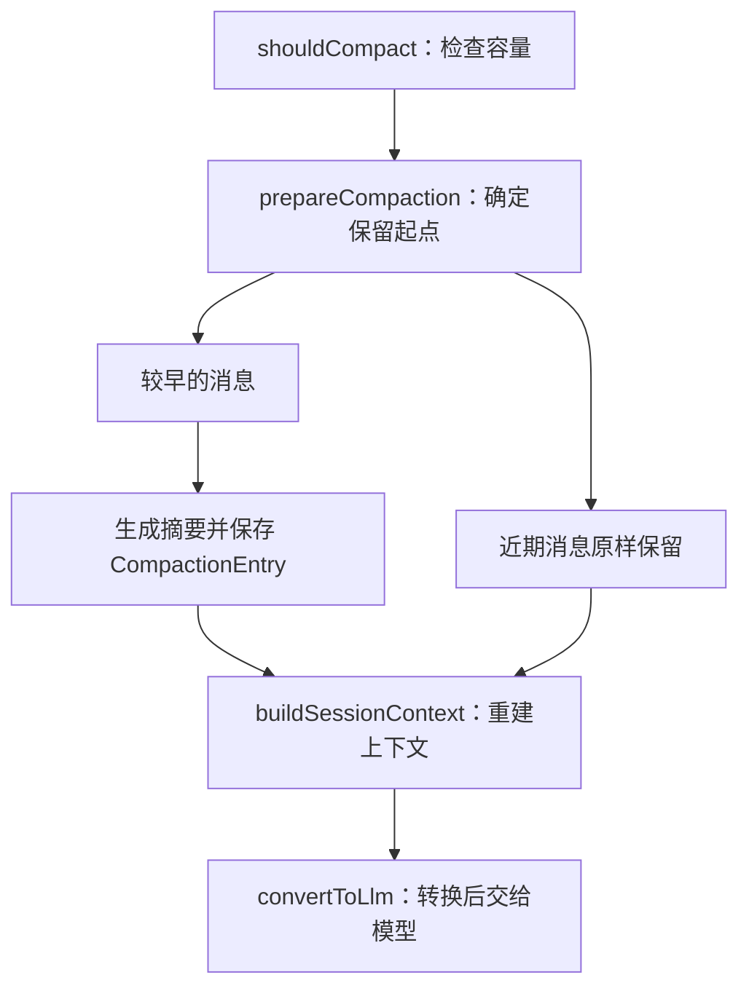

# Pi Agent 的上下文压缩：给长对话整理一份工作笔记

上一篇学习笔记中，我把上下文压缩留作了一个独立主题。这一篇结合 Pi Agent 的源码，详细梳理它怎样整理长对话，并让任务继续推进。

## 一、从完整历史到摘要与近期消息

上下文窗口可以想成一张大小固定的书桌。每次调用模型，需要把当前要参考的材料放上去，包括用户要求、之前的回复和工具结果。读文件、修改代码、运行测试，都会带来新的材料。对话越长，桌面就越拥挤。

例如修复购物车重复计费的问题：最初确定“保持现有接口”，之后读取 `cart.ts`、尝试修改，再检查测试输出。继续工作时，既需要记住最初的要求，也需要看到刚刚失败的测试，但早期的每一段日志已经没那么重要。

Pi 的 Compaction 会把较早的消息整理成摘要，同时保留近期消息原文。就像收起散落的材料，留下工作笔记和正在处理的几页。**压缩后，对话历史主要以“摘要＋近期消息”的形式参与下一次请求。**

这是一种有损整理：原先的具体措辞和部分执行细节会被省略，任务目标、限制和当前进度则尽量留下。因此，摘要是否抓住了重点，会影响后续工作能否顺利衔接。

## 二、先腾出继续工作的空间

`shouldCompact()` 用下面的条件判断是否需要自动压缩；前提是自动压缩已开启：

```ts
if (!settings.enabled) return false;
return contextTokens > contextWindow - settings.reserveTokens;
```

`reserveTokens` 是留给后续回复的空间。比如把窗口容量设为 100,000 token，预留 12,000，那么占用超过 88,000 就会触发检查条件。这里的数字用于举例，实际预算可以配置。Token 是模型衡量内容长度的单位，并不等于汉字数。源码会参考模型返回的用量，对缺少用量的部分再做估算。

自动检查安排在模型请求之间的边界。当前源码会在工具结果收齐、准备下一次模型回复时检查，也支持新提示开始前的检查、溢出后的压缩重试，以及 `/compact` 手动压缩。

## 三、决定哪些材料留在桌上

切点算法从最新消息往前累计 token，根据 `keepRecentTokens` 选择附近的合法位置。保留量按内容长度控制，因此每次留下的消息条数可能不同。

一次读文件可能返回大量代码，几条消息就占据很大空间；简短的讨论则可能留下更多条。这个预算是保留长度的目标，还需要配合合法消息边界，不能保证刚好等于指定数值。

这里的“切点”是保留区的第一条消息，它自己也会留下。普通用户消息和模型回复可以作为起点，工具结果不能单独作为起点，否则可能只留下结果，却丢掉对应的工具调用。

如果同一个用户请求引出了很长的执行过程，也可能从中间切开。这时，用户请求和切点前已经完成的步骤会进入 `turnPrefixMessages`，另外生成前缀摘要，补上近期消息需要的背景。

允许从中间切开，也是为了处理一次请求特别长的情况。如果必须保留整段执行过程，就可能连同大量工具输出一起留下，压缩后仍然腾不出足够空间。

## 四、摘要是一份交接笔记

`generateSummary()` 将待压缩的消息转换成文本，交给模型整理。提示词要求覆盖目标、约束与偏好、进度、关键决定、下一步和必要信息。进度还要区分已完成、进行中和受阻的工作。

在购物车的例子里，一份简化的笔记可以写成：“保持现有接口；已修改重复计费逻辑；刷新后重试的测试仍失败；下一步检查重试流程。”这样，后续工作有明确的落点。

再次压缩时，还会传入 `previousSummary`，把旧笔记与这次新压缩的消息合并更新，延续之前的要求和进度。例如重试问题已经修好，新摘要应把它移到“已完成”，并更新下一步要做的验证。这样维护的是持续变化的任务状态。摘要仍然会损失细节，固定格式只是帮助减少遗漏。

## 五、用摘要重建上下文



摘要生成后，会作为 `CompactionEntry` 写入会话记录，其中 `firstKeptEntryId` 标记保留起点。重建上下文时，`buildSessionContext()` 组合摘要、保留消息和后续新消息。原始历史仍在会话记录里，模型这次看到的材料则经过了整理。

摘要会先成为 `CompactionSummaryMessage`，再由 `convertToLlm()` 转成带 `<summary>` 标签的用户角色消息，随下一次请求发给模型。记忆的延续来自重新提供这些信息。

## 六、文件追踪保存的是路径

Pi 会从读写工具调用中提取文件路径，跨压缩累积，保存到 `details`，并以 `<read-files>`、`<modified-files>` 列表附在摘要末尾。这个步骤由代码完成，减少了完全依赖模型记住文件名的风险。

其中，`read` 调用归入读取记录，`edit` 和 `write` 调用归入修改记录。列表会去重；同一个文件既被读取又被修改时，会放进修改列表，避免两边重复出现。

这些列表只是文件索引，也占用上下文空间。读文件时返回的正文，仍可能随旧消息被摘要化；磁盘上的文件本身不会因此改变。像 `cart.ts` 的某段实现需要再次核对时，重新读取文件，就能把所需内容带回当前上下文。


---

## 源码参考

- [compaction.ts](https://github.com/earendil-works/pi/blob/main/packages/coding-agent/src/core/compaction/compaction.ts)：容量判断、切点选择、摘要生成与更新、文件记录累积。
- [agent-session.ts](https://github.com/earendil-works/pi/blob/main/packages/coding-agent/src/core/agent-session.ts)：自动压缩的调用边界与恢复流程。
- [session-manager.ts](https://github.com/earendil-works/pi/blob/main/packages/coding-agent/src/core/session-manager.ts)：压缩记录保存与上下文重建。
- [messages.ts](https://github.com/earendil-works/pi/blob/main/packages/coding-agent/src/core/messages.ts)：摘要消息转换。
- [utils.ts](https://github.com/earendil-works/pi/blob/main/packages/coding-agent/src/core/compaction/utils.ts)：文件路径提取、列表格式化与消息序列化。
- [官方压缩说明](https://github.com/earendil-works/pi/blob/main/packages/coding-agent/docs/compaction.md)：整体机制与配置项。

