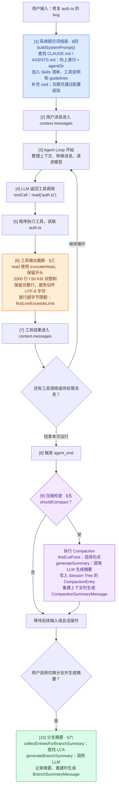

# 从完整链路理解 pi Agent 的上下文工程

这一节聊聊上下文工程，结合 pi 的实现，主要看系统提示词组装、工具输出截断、上下文压缩和分支摘要这四种机制。先走一遍完整链路，再分别看它们做什么、为什么需要它们。

## 一、完整链路：从用户输入到后续处理

假设我让 Agent：“修复 auth.ts 的 bug。”下面沿着这个请求走一遍。蓝色、橙色、紫色和绿色，分别标出了这次要讲的四种上下文工程机制。



模型先提出读取请求，程序实际打开文件，再把结果带回对话。模型看到代码后，才能决定下一步修改什么、调用什么工具。这个过程可以重复多次，直到本次运行结束。

请求模型前，`agent-loop.ts` 中有这样的处理：

```ts
let messages = context.messages;
if (config.transformContext) {
    messages = await config.transformContext(messages, signal);
}
const llmMessages = await config.convertToLlm(messages);
```

`transformContext` 像整理资料，可以筛选消息、补充检索结果；`convertToLlm` 像统一格式，把内部消息转换成模型接口接受的形式。前者是可选入口，不能直接等同于自动压缩。

图中展示的是主干链路。压缩检查也可以发生在两次模型请求之间；`agent_end` 表示一次运行结束，后续仍能在同一会话中继续提问。

## 二、上下文是什么，四种机制分别管什么

我把上下文理解成开卷考试时放在桌上的材料：用户请求是题目，项目规范是要求，历史消息是已有讨论，工具结果是刚查到的资料。

模型能根据什么判断，取决于这次交给它什么。硬盘上有文件，并不意味着模型自动知道内容；需要读取并带入上下文，它才能据此工作。

桌面大小有限。模型的上下文窗口通常用 token 衡量，token 是文本切分后的单位，不等于字数。因此，既要补齐必要材料，也要控制体积，并给回答留下空间。

四种机制各有分工：

| 图中颜色 | 机制 | 处理的问题 |
| --- | --- | --- |
| 蓝色 | 系统提示词组装 | 项目规则和 Skill 清单怎样进入上下文 |
| 橙色 | 工具输出截断 | 单次工具结果太大 |
| 紫色 | 上下文压缩 | 多轮历史逐渐占满窗口 |
| 绿色 | 分支摘要 | 切换路径后，怎样带上已有探索 |

## 三、工具输出截断：一次只交出适量材料

读取一个大文件，或者运行一次测试，都可能产生大量输出。全部塞给模型，会挤占其他信息的位置。

`truncate.ts` 里可以直接看到默认限制：

```ts
export const DEFAULT_MAX_LINES = 2000;
export const DEFAULT_MAX_BYTES = 50 * 1024;
```

也就是 2000 行和 50 KiB，先达到哪一道，就按哪一道限制输出。只限制行数不够，因为一行压缩代码就可能有几十 KB。

不同工具保留的位置不同：

| 函数 | 保留部分 | 典型用途 |
| --- | --- | --- |
| `truncateHead` | 开头 | read 读取文件 |
| `truncateTail` | 末尾 | bash 命令输出 |

命令末尾经常包含错误和最终结果，所以 bash 通常保留末尾。截断是按体积裁剪，没有让模型理解全文后生成摘要。

read 通常保留完整行。如果第一行本身就超过字节限制，会设置 `firstLineExceedsLimit`，再由工具提示模型换一种读取方式。这个标志对应的是“首行过大”，并非所有超限情况。

`TruncationResult` 记录截断情况，`ToolResultMessage` 则负责把工具结果接回对话。工具会把必要说明写成文字，让模型知道自己只看到了部分内容。

需要继续查阅时，read 可以分段读取；bash 超限输出会保存到临时文件，并给出路径。流式日志由 `OutputAccumulator` 收集和管理，但界面不断刷新，不等于模型在同一次生成中不断收到新日志。

## 四、系统提示词组装：规则先提供，指南按需展开

修复 auth.ts 时，项目可能规定“使用 pnpm”“修改后运行测试”“不要编辑生成文件”。这些固定要求适合写进项目规范，避免每次重新交代。

pi 的 `loadProjectContextFiles()` 会读取用户级规范，并从当前工作目录向上查找，再按全局、外层目录、内层目录的顺序组织。同一目录有多个候选文件时，会按顺序选取可读取的文件，并非全部叠加。

`buildSystemPrompt()` 及相关函数把规范、工具指导、Skill 清单等组织起来。规范外面的 `<project_instructions path="…">` 标签，类似资料的来源标签，标明边界和出处；标签本身不会执行规则。

工具和 Skill 也在这里分工。工具像设备，提供读取、修改、执行命令等能力；Skill 像操作手册，说明某类任务应该怎样做，也可以附带脚本和参考资料。

`skills.ts` 生成清单时，核心内容是：

```ts
lines.push(`    <name>${escapeXml(skill.name)}</name>`);
lines.push(`    <description>${escapeXml(skill.description)}</description>`);
lines.push(`    <location>${escapeXml(skill.filePath)}</location>`);
```

这里先交代“叫什么、做什么、去哪里读”。模型判断适用后，再通过 `read` 等工具读取 `SKILL.md`，随后按照指南调用工具。

因此，使用 Skill 也会经过工具调用：先读取方法，再执行操作。按需展开能减少初始输入，但读入的指南仍然占用上下文空间。

同样，按需搜索和读取项目资料也能补充上下文。RAG 的基本思路也是先检索相关材料，再交给模型，并不要求所有资料预先进入窗口。

## 五、上下文压缩：把长历史整理成摘要

截断控制的是单次输出，长会话中已经积累的消息则需要另一套处理方式。

Compaction 会把较早的历史整理成摘要，保留近期消息，再用于后续上下文。它需要考虑何时触发、在哪里切分，以及怎样保留目标、约束和进度。

这部分关系到 Agent 能否在长任务中继续工作，也有更多细节。下一篇[《Pi Agent 的上下文压缩：给长对话整理一份工作笔记》](compaction.md)会单独讲清楚，这里先保留它在完整链路中的位置。

## 六、分支摘要：换一条路径，带上此前的探索

如果先尝试方案 A，发现不合适，再回到历史节点探索方案 B，新分支的上下文未必包含 A 分支的过程。

分支摘要用来衔接这部分信息。选择生成摘要时，`collectEntriesForBranchSummary()` 会先寻找两条路径的最近公共祖先，也就是共同的分叉点。源码先取出两条路径：

```ts
const oldPath = new Set(session.getBranch(oldLeafId).map((e) => e.id));
const targetPath = session.getBranch(targetId);
```

随后从目标路径往回找共同节点，收集旧路径上需要总结的记录，再由 `generateBranchSummary()` 调用模型生成摘要。

这像换一种解题方法时，带上一张“此前尝试记录”，保留目标、进度和关键决策，减少重复探索。

摘要作为 `BranchSummaryMessage` 进入后续上下文时，还会通过 `convertToLlm` 转换成带说明的普通用户消息。保存的会话记录，与这次实际发送给模型的材料，仍然需要分开理解。

## 七、把四种机制放回同一条链路

系统提示词组装提供规则和指南入口；工具输出截断控制新材料的体积；上下文压缩整理已经积累的历史；分支摘要衔接另一条路径上的探索。

它们共同决定了模型这次能看到什么。模型判断下一步，工具完成实际操作，结果再回到上下文，供下一次判断使用。沿着这条循环看源码，就能理解每一处整理、裁剪和摘要处理为什么出现在那里。
