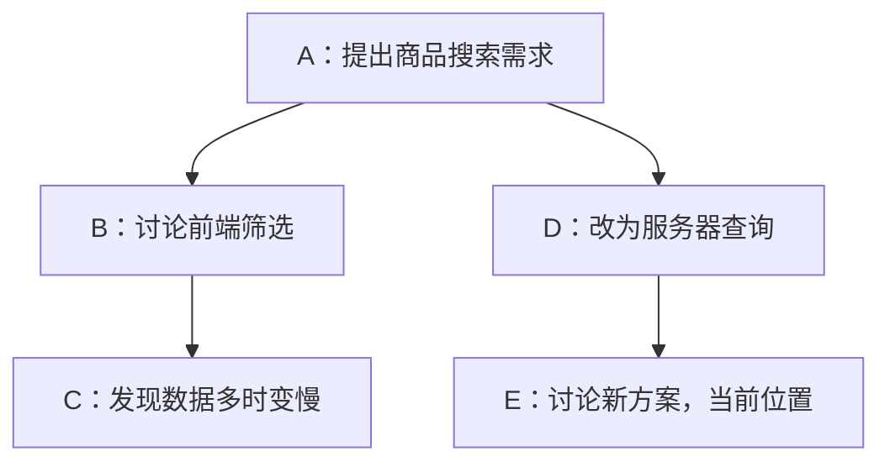

# Pi Agent 的会话管理：一本可以换路线的工作笔记

读 Pi Agent 源码时，我把会话管理理解成一本带书签的工作笔记：笔记留下讨论和尝试，书签标出当前的位置。关闭程序以后，还能根据这些记录，重新整理出继续工作需要的内容。

## 一、保存方式与历史结构

Pi 的 coding-agent 默认把会话存在本地 JSONL 文件中，按项目路径分组，放在 `~/.pi/agent/sessions/` 下。JSONL 就是一行一个 JSON 对象：第一行介绍这个会话，后面每行记录消息、状态变化等内容。

对于本地运行的编码助手，JSONL 用起来比较直接：不需要另起数据库服务，文件可以直接打开查看，新记录也便于逐行追加。

历史之间的关系则采用树形结构。线性的历史只表达一条从头到尾的路线，但调试经常需要回退、重试和比较方案。用单条消息数组保存多个版本，通常还要另存副本或增加分支管理。树能让不同路线共用前面的记录，再分别保存各自的后续内容。尝试新方案时，旧方案也能留下，代价是历史会占用更多空间。

**JSONL 负责保存数据，树负责组织关系。** 存储介质也可以按需要扩展：既可以用 JSONL，也可以用数据库，选择适合自己的方式即可。JSONL 适合直接在本地留档，数据库便于集中管理会话。接入数据库时，需要提供相应的读写实现，但 `id`、`parentId` 表达的树形关系和上下文重建的思路仍能沿用。

这些记录比屏幕上的聊天文字丰富。用户提问、助手回复和工具返回结果会被保存，切换模型、调整思考级别也有对应记录。因此，恢复会话时，既能接上讨论，也能提取继续运行需要的设置。

会话文件建立后，新记录通常追加到末尾。源码中的 `_appendEntry()` 会把记录放进内存，再登记到 `byId` 这个“按编号查记录”的表里，移动当前位置，最后交给持久化方法保存。这种日常追加的方式，通常称为 **append-only**。

```ts
this.fileEntries.push(entry);
this.byId.set(entry.id, entry);
this.leafId = entry.id;
this._persist(entry);
```

### 会话里有哪些 Entry

Entry 可以理解成工作笔记里的一条记录。当前所读的 coding-agent 源码定义了 **11 种 Entry**，文件开头的 `SessionHeader` 是会话说明，不算树上的节点。

| Entry 类型 | 记录什么 |
| --- | --- |
| `SessionMessageEntry` | 用户、助手和工具结果等消息 |
| `ModelChangeEntry` | 切换模型 |
| `ThinkingLevelChangeEntry` | 调整思考级别 |
| `CompactionEntry` | 压缩摘要和原文保留起点 |
| `BranchSummaryEntry` | 旧路线的摘要，供当前路线参考 |
| `CustomEntry` | 扩展自己需要保存的数据 |
| `CustomMessageEntry` | 扩展希望带入模型上下文的消息 |
| `ContextEditEntry` | 调整旧消息在当前上下文里的呈现，保留原记录 |
| `UsageEntry` | 模型调用的用量统计 |
| `LabelEntry` | 给节点添加标签或书签 |
| `SessionInfoEntry` | 会话名称等元信息 |

## 二、用书签选择继续工作的路线

文件里的记录虽然一行接一行，会话的关系却可以分叉。假设正在做商品搜索，先尝试前端筛选，后来想改成服务器查询。两次尝试都可以留在同一个会话里：



实现这个结构，靠的是 `id` 和 `parentId`：前者是记录的编号，后者说明它接在哪条记录后面。B 和 D 都接在 A 后面，因此形成两条路线。新增 D 时，只需要让 D 指向 A，A 本身无需修改。

`leafId` 就像那枚书签，标记当前工作位置。通过 `branch()` 回到 A 后，下一条记录就以 A 为父节点，新路线自然出现，B、C 仍然保留。以后想查看旧方案，也能找到原来的讨论。

## 三、buildSessionContext：从树里选出当前路线

恢复会话时，读出文件只是第一步。程序会重新建立 `byId` 索引，通常以最后写入的记录作为当前位置，再整理当前路线需要的上下文。

这项工作通过 `buildSessionContext()` 完成。当前源码把它拆成几个步骤：`buildSessionPath()` 找路线，`buildContextEntries()` 处理压缩边界，`buildSessionProjection()` 将选中的记录转换成消息，并整理模型和思考级别等信息。

先看找路线这一步。上图的位置是 E，程序沿 `parentId` 依次找到 E、D、A，再反转为 A、D、E。这样就恢复了从早到晚的顺序。B、C 保留在历史里，但这次选择的路径经过 D，因此不会把旧方案的完整对话一起加入。

`buildSessionPath()` 中的这段循环，就对应“向前找，再反转”的过程：

```ts
while (current) {
    path.push(current);
    current = current.parentId ? index.get(current.parentId) : undefined;
}
path.reverse();
```

接下来按记录类型处理：普通消息进入 `messages`；模型、思考级别等信息用于恢复设置；会话名称等元数据有其他用途。如果路径里有分支摘要，它也可以转成消息，让后续工作了解之前尝试过什么。

把换模型也记成节点，是为了留下“什么时候、在哪条路线里换过”的信息。假设先使用模型 1，后来切到模型 2；若只把一个 `currentModel` 变量覆盖成模型 2，旧值和切换位置就丢了。保存变更节点后，回到切换之前的位置，所选路径不包含那次变更，程序就能沿当时的路线重新提取设置。

节点保存变化历史，运行时仍会用状态表示当前模型和思考级别。两者配合，既能继续工作，也有依据回到之前的设置。

最终得到的是消息列表和相关设置。到模型调用这一层，仍要通过消息转换适配接口；模型接收的是整理后的消息序列。

`sdk.ts` 初始化会话时，也会调用这个方法，读取已有会话的上下文：

```ts
const existingSession = sessionManager.buildSessionContext();
```

## 四、有压缩记录时，怎样拼接上下文

沿用上一篇修复购物车重复计费的例子：最初要求“保持现有接口”，随后读取 `cart.ts`、修改逻辑，再运行测试。对话变长后，较早的过程生成摘要，近期测试相关消息保留原文。

摘要作为 `CompactionEntry` 写进会话，其中 `firstKeptEntryId` 标记“从哪条旧记录开始保留原文”。下面省略其他节点，只展示重建时需要关注的部分，编号也做了简化：

| 记录位置 | 内容 | 重建时的处理 |
| --- | --- | --- |
| 较早的记录 | 用户约束、读取和修改 `cart.ts` 的过程 | 使用摘要承接 |
| k1：助手消息 | 发起测试工具调用 | 保留原文 |
| k2：工具结果 | 刷新后重试的测试仍失败 | 保留原文 |
| c1：压缩记录 | 保存摘要，`firstKeptEntryId = k1` | 生成摘要消息 |
| n1：后续用户消息 | “继续检查重试流程” | 加入上下文 |
| n2：后续助手消息 | 新的分析或工具调用 | 加入上下文 |

这里的 k1 自己也会保留，因此测试调用和结果能够一起进入上下文。程序找到当前路径上最近的压缩记录后，会把摘要放在前面，接上压缩之前从 k1 开始的保留消息，再接上压缩之后的新消息。

在 `buildContextEntries()` 中，压缩记录和此前保留的近期记录已经放进 `contextEntries`，随后通过下面这行源码接上后续内容：

```ts
contextEntries.push(...path.slice(compactionIdx + 1));
```

`compactionIdx` 是压缩记录在当前路径中的位置，从它的下一项开始取，就能得到压缩之后的新记录。

在这个简化例子中，消息顺序就是：**摘要 + k1 + k2 + n1 + n2**。

摘要可以写成：“保持现有接口；已修改重复计费逻辑；刷新后重试的测试仍失败；下一步检查重试流程。”后面的工具结果则保留具体错误，方便继续定位问题。

生成摘要发生在压缩流程中；`buildSessionContext()` 使用已经保存的摘要和边界进行组合。因此，关闭后重新打开会话，也能重建这份“概要加近期材料”。

## 五、完整笔记与当前桌面

**完整历史负责留档，模型上下文负责当前工作。** JSONL 文件里保留着旧记录、其他分支和压缩摘要；当前上下文则按照选中的路线和压缩边界整理。

就像工作笔记越写越厚，桌面上可以只放概要和正在处理的几页，需要细节时再翻原页。压缩后，早期消息仍留在历史中；回到压缩记录之前的节点时，那条路径还没有经过这次压缩，便可以按原来的消息重建。

这次阅读带来的一个收获，是把“存在哪里”和“记录怎么关联”分开考虑。JSONL 解决保存的问题，树形关系支持不同的尝试；换成数据库，也可以用 `id` 和 `parentId` 保存这棵树。会话管理把工作过程留下来，再从中选出下一步需要的内容。

---

## 源码参考

- [session-manager.ts：Entry 类型、记录追加、路径遍历与上下文构建](https://github.com/earendil-works/pi/blob/main/packages/coding-agent/src/core/session-manager.ts)
- [sdk.ts：会话初始化与状态恢复](https://github.com/earendil-works/pi/blob/main/packages/coding-agent/src/core/sdk.ts)
- [Pi 官方会话文件格式文档](https://github.com/earendil-works/pi/blob/main/packages/coding-agent/docs/session-format.md)
- [Pi 官方 SDK 文档：会话存储与恢复](https://github.com/earendil-works/pi/blob/main/packages/coding-agent/docs/sdk.md)
- [compaction.ts：摘要生成与保留起点的计算](https://github.com/earendil-works/pi/blob/main/packages/coding-agent/src/core/compaction/compaction.ts)
- [messages.ts：消息与摘要的转换](https://github.com/earendil-works/pi/blob/main/packages/coding-agent/src/core/messages.ts)
